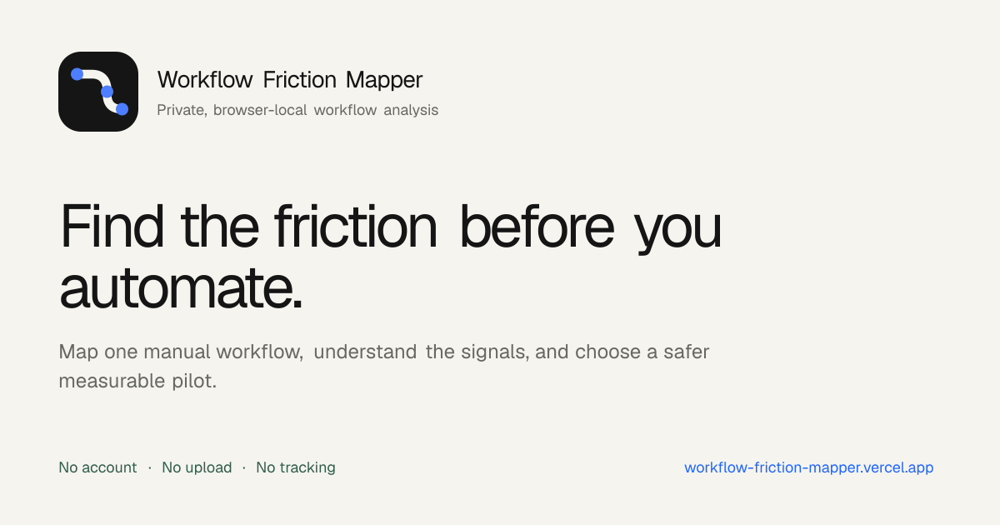
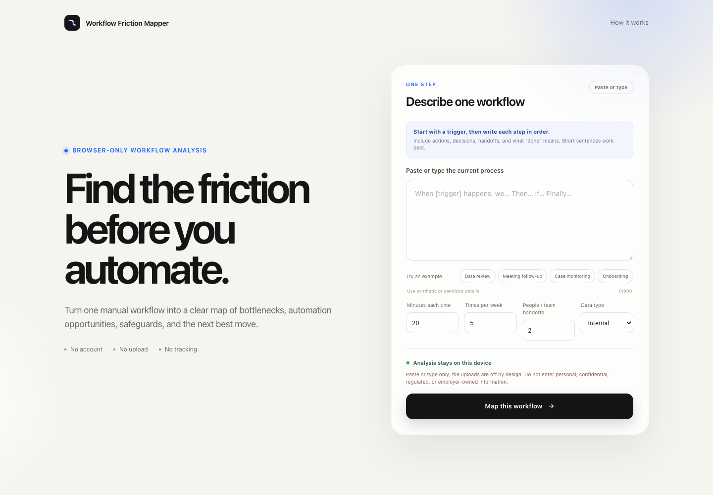
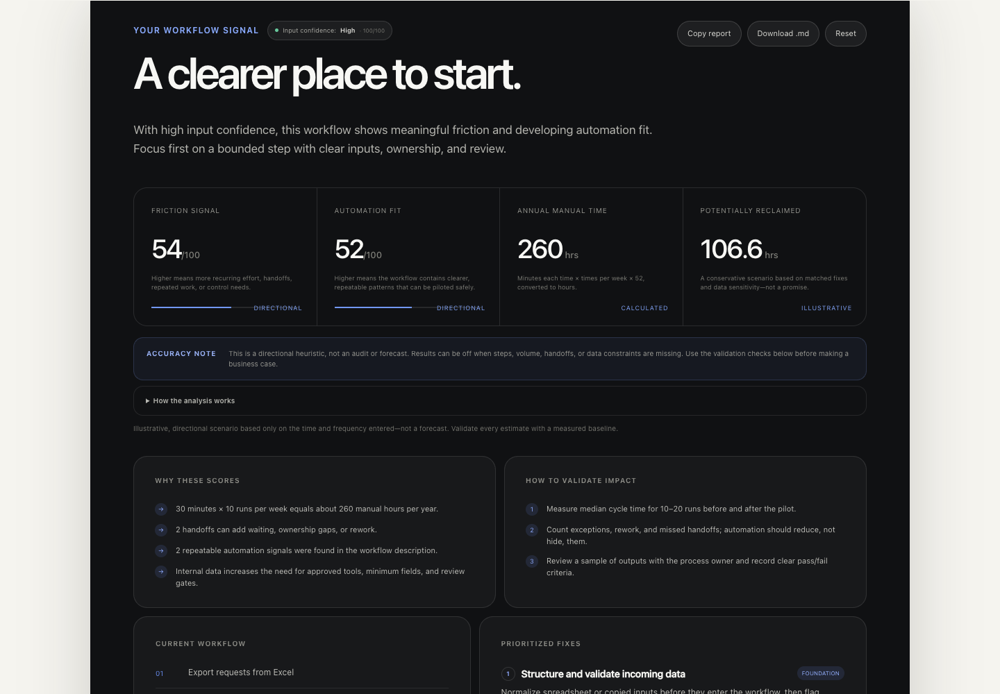
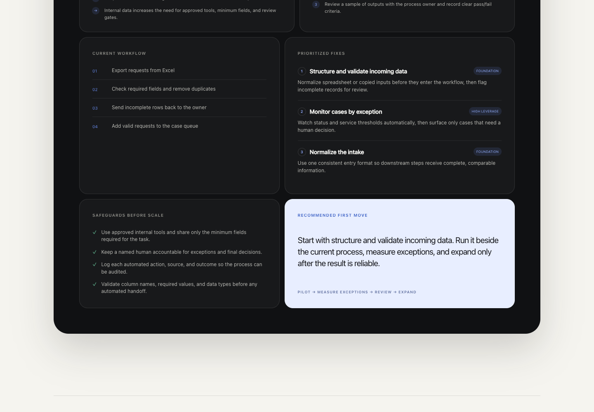
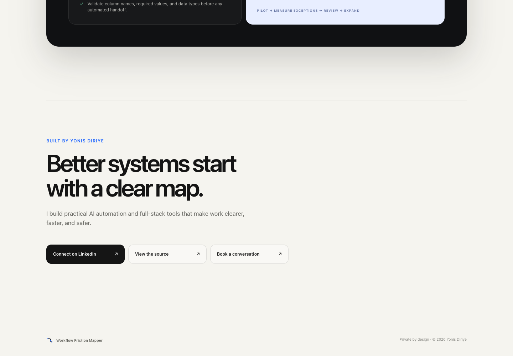

# Workflow Friction Mapper



A chat agent that turns a workflow into a proposed automation plan, with friction, open questions and a first move.

**[Open the live tool](https://workflow-friction-mapper.vercel.app)** · **[View the source](https://github.com/Yasuui/workflow-friction-mapper)**

Built by [Yonis Diriye](https://www.linkedin.com/in/yonisdiriye/).

[](https://github.com/Yasuui/workflow-friction-mapper/actions/workflows/ci.yml)

## Status

| Part | State |
| --- | --- |
| Public site | Live on Vercel, running in **demo mode** |
| Demo agent | Deterministic: rule-based step extraction and evidence labelling, covered by tests |
| Live model path | Built (`gpt-5-mini` via the Vercel AI SDK) but **not enabled in production** and not yet evaluated against a golden set |
| API boundary | Validated: roles, part types, sizes and inline attachments are checked before any parsing or model call |
| Users | No accounts, no stored workflow data |

What this is not yet: a measured product. There are no outcome metrics beyond opt-in usefulness feedback, and the live model has not been graded.

The build-plan interface is under review. Before enabling a public paid model, add durable abuse and spend controls, evaluate live output against representative cases, and verify the deployed journey. The local key is not a production deployment or evidence of model quality.

## Why it exists

Teams often automate a process before they understand it. This agent is the first conversation: extract the real steps, name the friction, and pick one reversible move.

## How it works

1. **Land in chat.** The agent greets you. Paste a process, attach a SOP/notes file, or tap a starter.
2. **Read what you share.** Text, Markdown, CSV, JSON, and PDF text go to the optimizer. Images go to the live model when a key is present.
3. **Get a brief in the thread.** Spoken summary plus a structured report card. Claims are facts from your material or labeled inferences — no invented hours or tools.
4. **Take it with you.** Copy, download Markdown (`workflow-optimization-brief.md`), or download PDF (`workflow-optimization-brief.pdf`).

Without `OPENAI_API_KEY` the UI runs in **demo mode** (a polished streamed sample grounded in what you typed). With a key, `/api/optimize` uses **gpt-5-mini** (`MODEL`, fallback `gpt-4.1-mini`).

The tool does not replace process owners, security review, or measured validation.

## Product views

### One-step workflow input



### Transparent KPI report



### Prioritized fixes and safer first move



### Direct contact and source actions



## What is and is not collected

- No account
- Chat messages and attachments are sent to `/api/optimize` so the agent can read them
- In live mode that content is sent to the model provider (OpenAI)
- Cookieless, explicit-event-only product analytics; no autocapture or session replay
- Workflow text is never sent to PostHog

See [PRIVACY.md](PRIVACY.md). Analytics definitions live in [docs/analytics-event-contract.md](docs/analytics-event-contract.md).

## What the brief includes

- A proposed build plan: trigger, inputs, steps, human review, failure handling and checks before launch
- Details that need confirmation, rather than a claim that the automation is already running
- Ordered current steps
- Friction and bottlenecks with evidence (fact vs inference)
- Opportunities tied to named steps
- One first move
- Optional hours only when you stated volume
- Copy, Markdown, and PDF export

## Run locally

Requirements: Node.js 22.13 or newer.

```bash
npm install
npm run dev
```

Open `http://localhost:3000`. Demo mode works with no API key. To use the live model later, copy `.env.example` to `.env.local` and set `OPENAI_API_KEY` and `MODEL=gpt-5-mini`.

## Verify

```bash
npm run lint   # ESLint with the React Compiler rules
npm test       # tsc --noEmit, next build, then node --test against the built output
```

CI runs both on every pull request with no model key, so the suite never calls a paid API.

What the tests cover:

- **Evidence honesty.** Keyword-derived friction, bottlenecks and opportunities are always labelled as inferences, in the card and in the Markdown export. Hours appear only when the user stated volume.
- **Step extraction.** Data classifications ("Internal data") are not counted as steps; real actions on data are kept.
- **API boundary.** The payloads the UI really sends pass. System-role injection, remote file URLs, mislabelled binaries, malformed JSON and oversized bodies are rejected with 4xx, never 500.
- **Rendering and export.** The pre-rendered shell, file names, SEO routes and the data-URL download path.

Not covered yet: live-model output quality, browser end-to-end tests, and mobile layouts on physical devices.

## Product architecture

```text
Chat + attachments (type and size checked in the browser)
      |
/api/optimize
  ├─ request guard (lib/optimize-request.ts)  → 400 / 413 / 415 with a readable message
  ├─ no key:  deterministic demo agent, streamed
  └─ keyed:   gpt-5-mini, PDF text extracted server-side, stated volume passed as arithmetic only
      |
Spoken reply + structured brief (fenced JSON, parsed and validated client-side)
      |
Copy / workflow-optimization-brief.md / .pdf
```

Design choices worth knowing:

- **Facts vs inferences is a data field, not wording.** Every evidence item carries `kind: "fact" | "inference"`, so the UI, the Markdown and the PDF can't drift apart.
- **Hours come from code, not the model.** Annual hours are computed from the user's own numbers and passed to the model as a fact; the prompt forbids inventing them. The parser does not yet reject a figure the model makes up anyway. That check belongs in the live-model eval set.
- **The browser history is untrusted.** The server rebuilds each message from an allowlist instead of forwarding the client's payload.

Core stack: Next.js, React, TypeScript, Vercel AI SDK, Tailwind CSS, and Vercel.

## Connect

- [LinkedIn](https://www.linkedin.com/in/yonisdiriye/)
- [GitHub](https://github.com/Yasuui)
- [Book a conversation](https://cal.com/yonis-diriye)

## License

[MIT](LICENSE)
